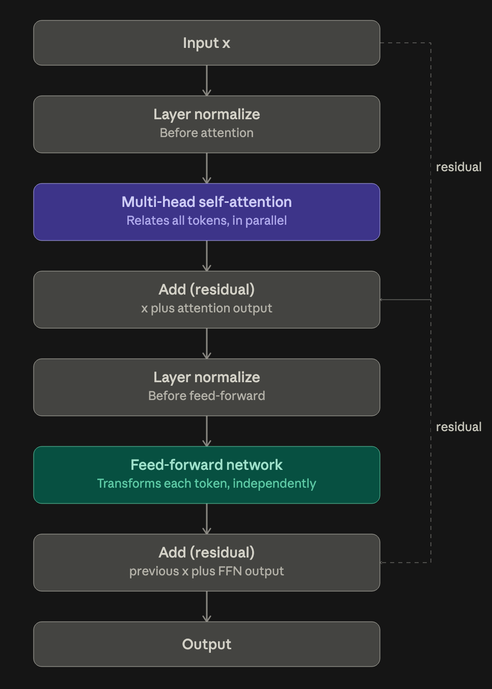

# Chapter 4: implementing a GPT model from scratch

Sections 4.1 to 4.7.

Everything up to here has been one piece at a time. This chapter is where the pieces get stacked into something you can actually feed tokens to.

**Contents**

- [Background: the forward and backward pass](#background-the-forward-and-backward-pass)
- [4.1 The GPT skeleton](#41-the-gpt-skeleton)
- [4.2 Layer normalization](#42-layer-normalization)
- [4.3 Activations and the feed forward network](#43-activations-and-the-feed-forward-network)
- [4.4 Shortcut connections](#44-shortcut-connections)
- [4.5 The transformer block](#45-the-transformer-block)
- [4.6 Coding the GPT model](#46-coding-the-gpt-model)
- [Where this lands](#where-this-lands)
- [4.7 Generating text](#47-generating-text)

---

## Background: the forward and backward pass

**Forward pass.** Push an input through every layer in order. Each layer caches its own input on the way, and the last one produces the output, whether that is a prediction, a classification, or a set of logits.

**Backward pass.** Start at the loss and walk back through the layers in reverse. Every layer does the same four things:

1. Uses its cached input to compute its local derivative.
2. Multiplies that into the gradient handed down from the layer after it.
3. Keeps a copy of the result as the gradient for its own weights. This is the part training actually uses.
4. Passes the product on to the layer before it. This is the only reason $\partial L/\partial x$ gets computed at all.

### A two layer example

Layer 1 owns $g$, layer 2 owns $f$, so the model computes $f(g(x))$.

Going forward:

- Layer 1 computes $g(x)$ from the input $x$, caches $x$, passes $g(x)$ on. It only ever has to know its own function.
- Layer 2 computes $f(u)$, where $u = g(x)$ is whatever came in. It caches $u$ and outputs the result. Same deal, it never needs to know what layer 1 did.

Coming back:

- The loss seeds the chain with $\partial L/\partial L = 1$, then immediately produces a real number $\partial L / \partial \text{out}$. For MSE that is $2(\text{out} - \text{target})/n$, not 1. The bare 1 is only the seed and never survives past the loss function itself.
- Layer 2 computes $f'(u)$ from its cached $u$, multiplies by what came from the loss, and passes the product down.
- Layer 1 computes $g'(x)$ from its cached $x$ and multiplies into what came down, giving $\frac{\partial L}{\partial x} = f'(g(x)) \cdot g'(x)$.
- Nothing goes back up.

$\frac{\partial L}{\partial x} = \frac{\partial L}{\partial f} \cdot \frac{\partial f}{\partial g} \cdot \frac{\partial g}{\partial x}$

Two things worth holding onto. First, each layer only ever knows its own derivative and the number handed to it. That is the whole trick, the chain rule turns into passing one number backwards. Second, the $\partial L/\partial x$ that falls out at the very bottom is normally thrown away, because you cannot train the input. The useful outputs are the per-layer $\partial L / \partial W$, and the chain is walked all the way down only because the layers underneath still need their turn.

---

## 4.1 The GPT skeleton

The target is GPT-2 small, 124 million parameters. The whole configuration is one dict.

```python
GPT_CONFIG_124M = {
    "vocab_size": 50257,     # BPE vocab from ch. 2
    "context_length": 1024,  # rows in the positional embedding table
    "emb_dim": 768,          # every token is a 768-dim vector
    "n_heads": 12,           # attention heads per block
    "n_layers": 12,          # transformer blocks stacked
    "drop_rate": 0.1,        # 10% dropout
    "qkv_bias": False        # no bias on W_q, W_k, W_v
}
```

**Parameter.** Any trainable weight in the model. A single $2048 \times 2048$ weight matrix is $4{,}194{,}304$ parameters on its own, and "124 million" is just the count of every such number added up.

### The data flow

This never changes for the rest of the book.

**1. Token IDs come in with shape `(batch, num_tokens)`.**

The batch size is a hyperparameter. It is the number of training examples pushed through before the internal parameters get updated once.

**2. Token embedding plus positional embedding, giving `(batch, num_tokens, 768)`**

Each token is a 768-dimensional vector, where 768 is the dimension of the embedding layer.

**3. Dropout.**

Prevents overfitting, by doing random deactivation.

**4. Twelve transformer blocks, each preserving the shape.**

Transformer blocks are their own separate existing architecture. Made up of 4 components, **normalize -> multi-head self attention -> add, then normalize -> feed-forward network -> add**. In GPT-2, it does this 12 times.

The token from the embedding layer is then passed onto the **attention layer**. Each attention layer splits the 768-dim token into 12 heads, with each head being 64-dim.

The **attention layer** relates the tokens in parallel. It computes a query vector and compares it against the key vectors of every token at or before it, **all at once** through matrix multiplication, uncovering relationships between the tokens.

**Feed forward layer** is where each token "thinks" about what it just gathered, using the extra capacity to represent more complex, nonlinear features. It applies the same transformation to each token's vector independently, with no cross-token interaction at all.

**Add & normalize.** **Add** (residual connection) takes the sub-layer's input and adds it directly to the sub-layer's output. **Normalize** (layer normalization) re-centers and re-scales each token's vector independently.

**5. A final LayerNorm.**

**6. An output head projecting $768 \to 50257$**, giving one score per vocabulary entry per position.

Those final scores are called **logits**. They are raw and unnormalised, and there are 50,257 of them per position because each dimension stands for one specific token in the vocab.

One transformer block, drawn. This is what step 4 does twelve times.



### DummyGPTModel

Worth writing once and then deleting. It stubs `TransformerBlock` and `LayerNorm` as identity functions that return `x` untouched, which proves the skeleton already runs end to end and produces the right output shape: `(2, 4)` token IDs in, `(2, 4, 50257)` logits out. Everything from 4.2 onwards is filling in those two stubs.

---

## 4.2 Layer normalization

**The problem.** Deep stacks suffer vanishing or exploding gradients, so training either stalls or blows up.

**The fix.** Rescale each token's vector so it has mean 0 and variance 1.

$$\hat{x} = \frac{x - \mu}{\sqrt{\sigma^2 + \epsilon}}, \qquad \text{out} = \gamma \hat{x} + \beta$$

```python
class LayerNorm(nn.Module):
    def __init__(self, emb_dim):
        super().__init__()
        self.eps = 1e-5
        self.scale = nn.Parameter(torch.ones(emb_dim))
        self.shift = nn.Parameter(torch.zeros(emb_dim))

    def forward(self, x):
        mean = x.mean(dim=-1, keepdim=True)
        var = x.var(dim=-1, keepdim=True, unbiased=False)
        norm_x = (x - mean) / torch.sqrt(var + self.eps)
        return self.scale * norm_x + self.shift
```

Reading the arguments one at a time:

- **`dim=-1`** means the last dimension, so the statistics are taken **across one token's 768 features**. Not across the batch, and not across the sequence. Each token vector is normalised on its own, knowing nothing about its neighbours.
- **`keepdim=True`** keeps the reduced axis as size 1 instead of dropping it. A `(2, 4, 768)` input gives a mean of shape `(2, 4, 1)`, which broadcasts cleanly back against `x`. Without it you get `(2, 4)` and the subtraction breaks.
- **`eps = 1e-5`** stops a division by zero when a token's features happen to be identical.
- **`unbiased=False`** divides by $n$ instead of $n-1$, skipping Bessel's correction. At $n = 768$ the two differ by a factor of $\frac{n}{n-1} \approx 1.0013$, measured. It matters only because GPT-2's original TensorFlow code did it this way, and ch. 6 loads those weights.

**`scale` ($\gamma$) and `shift` ($\beta$) are trainable.** They start at 1 and 0, so the layer begins life as pure normalisation, and training can undo or reshape that normalisation if it turns out to help. Without them the layer would be a fixed transform with no capacity of its own.

### Layer norm vs batch norm

Batch norm normalises down the batch dimension, so every example's result depends on the others in its batch. Layer norm normalises across features, so an example is independent of batch size entirely. It works with a batch of 1, it works when the batch size changes, and it works in distributed training. That independence is why LLMs use it.

---

## 4.3 Activations and the feed forward network

### Why an activation function at all

**TLDR.** Without an activation, a stack of linear layers collapses into a single linear layer, so depth buys nothing. GELU is the bend that stops that collapse, and you can see it in how the curve treats different inputs: large positive values pass through nearly unchanged, large negative values get pushed close to zero, and values near zero get a smooth, curved transition rather than a sharp cutoff. Three different rates of change within one function is exactly what nonlinear means, and it's what a straight line can never do.

Stack linear layers with nothing between them and the whole stack collapses.

$W_2(W_1 x) = (W_2 W_1)x = W' x$

Twelve linear layers in a row are algebraically one linear layer, so the depth buys you nothing no matter how many you add. An activation function inserts a nonlinear step between the linear ones, which makes that collapse impossible, and each added layer then genuinely extends what the network can express.

Geometrically, the activation bends the space the data sits in, stretching some regions and compressing others. Data that no straight line can separate in the input space gets warped into an arrangement the final layer **can** split with a plain hyperplane. The data itself never changes, the space it lives in does.

The activation needs a usable derivative, since the backward pass asks every layer for one. It does **not** need to be differentiable everywhere. ReLU has a corner at $x = 0$ and is still the most widely used activation there is. PyTorch just picks a value there, measured: `d(ReLU)/dx` at `x=0` returns `0.0`, no error. Differentiable almost everywhere is enough, because hitting the kink exactly is a measure-zero event.

### ReLU vs GELU

$\text{ReLU}(x) = \max(0, x) \qquad \text{GELU}(x) = x \cdot \Phi(x)$

$\Phi$ is the cumulative distribution function of the standard Gaussian. GPT-2 uses a cheaper curve-fitted approximation:

```python
class GELU(nn.Module):
    def forward(self, x):
        return 0.5 * x * (1 + torch.tanh(
            torch.sqrt(torch.tensor(2.0 / torch.pi)) *
            (x + 0.044715 * torch.pow(x, 3))
        ))
```

ReLU outputs zero for every negative input, so its gradient there is exactly zero. A neuron pushed negative stops receiving any gradient and can stay stuck.

GELU is smooth, and its output for negative inputs is small but nonzero, so neurons receiving negative input still contribute to learning, just less. Measured gradients: $-0.086$ at $x = -2$, $-0.083$ at $x = -1$, $+0.133$ at $x = -0.5$. It does pass through zero once, measured at $x \approx -0.7525$, which is GELU's minimum, so "nonzero gradient for all negatives" is nearly true with that one point as the exception.

The smoothness is the real argument, though. A sharp corner makes optimisation harder in very deep stacks.

### FeedForward

```python
class FeedForward(nn.Module):
    def __init__(self, cfg):
        super().__init__()
        self.layers = nn.Sequential(
            nn.Linear(cfg["emb_dim"], 4 * cfg["emb_dim"]),
            GELU(),
            nn.Linear(4 * cfg["emb_dim"], cfg["emb_dim"]),
        )
```

Expand, activate, contract. Measured, $768 \to 3072 \to 768$, a factor of 4.

- **The width in the middle is where the capacity lives.** The nonlinearity gets applied in the roomier space, then the result is squeezed back.
- **Input and output dimensions match on purpose.** That is what lets you stack twelve of these without reshaping anything between them.
- **It acts on each token position separately.** Attention is the part that mixes tokens together, the feed forward is the part that processes each one alone. The two jobs are deliberately split.

---

## 4.4 Shortcut connections

Also called skip or residual connections. They came from computer vision, aimed at the vanishing gradient problem.

**Vanishing gradients.** Gradients get progressively smaller as they propagate backward, so the earliest layers barely move. It follows from the chain rule, since each layer multiplies in one more factor, and if those factors are mostly below 1 the product shrinks geometrically with depth. By layer 1 of a 12 layer stack the gradient can be orders of magnitude smaller than at layer 12. The early layers are the ones that see the raw input, so they are exactly the ones you cannot afford to leave untrained.

The fix is one line in the forward pass.

```python
layer_output = layer(x)
if self.use_shortcut and x.shape == layer_output.shape:
    x = x + layer_output      # instead of x = layer_output
else:
    x = layer_output
```

Adding the input back gives the gradient a second, shorter route around the layer. The derivative of $x + F(x)$ is $1 + F'(x)$, and that $1$ is the whole point. It is an additive path, so the gradient can reach an early layer without being multiplied down by everything in between.

The shape check is there because you can only add two tensors of the same shape. The last layer of the demo network goes $3 \to 1$, so it gets no shortcut.

Measured on the 5 layer demo, mean $|\text{grad}|$ per layer:

| layer    | no shortcut | with shortcut | factor |
| -------- | ----------- | ------------- | ------ |
| layers.0 | 0.000202    | 0.221698      | 1099x  |
| layers.1 | 0.000120    | 0.206941      | 1723x  |
| layers.2 | 0.000715    | 0.328970      | 460x   |
| layers.3 | 0.001399    | 0.266573      | 191x   |
| layers.4 | 0.005050    | 1.325854      | 263x   |

Without shortcuts the gradient falls off by 25x from the last layer to the first. With them it falls off by 6x, and layer 0 receives a gradient roughly 1100 times larger. The last layer still has the biggest gradient either way, which is expected, since it sits closest to the loss.

---

## 4.5 The transformer block

Everything from 4.2 to 4.4 plus chapter 3's attention, assembled. This block is repeated 12 times in GPT-2 small.

```python
class TransformerBlock(nn.Module):
    def __init__(self, cfg):
        super().__init__()
        self.att = MultiHeadAttention(
            d_in=cfg["emb_dim"], d_out=cfg["emb_dim"],
            context_length=cfg["context_length"],
            num_heads=cfg["n_heads"], dropout=cfg["drop_rate"],
            qkv_bias=cfg["qkv_bias"])
        self.ff = FeedForward(cfg)
        self.norm1 = LayerNorm(cfg["emb_dim"])
        self.norm2 = LayerNorm(cfg["emb_dim"])
        self.drop_shortcut = nn.Dropout(cfg["drop_rate"])

    def forward(self, x):
        shortcut = x                      # attention sub-block
        x = self.norm1(x)
        x = self.att(x)
        x = self.drop_shortcut(x)
        x = x + shortcut

        shortcut = x                      # feed forward sub-block
        x = self.norm2(x)
        x = self.ff(x)
        x = self.drop_shortcut(x)
        x = x + shortcut
        return x
```

### Two sub-blocks, same shape

Both do the same four steps: normalise, transform, drop, add the input back.

- **Attention** mixes information *between* token positions.
- **Feed forward** transforms each position on its own.

So one block does "look around", then "think about what you found". Each sub-block gets its own LayerNorm, hence `norm1` and `norm2`, and its own shortcut, so a 12 block model has 24 skip paths for the gradient.

### Pre-LayerNorm

The norm goes **before** attention and feed forward, not after. The original 2017 transformer put it after, which is post-LayerNorm.

Measured on a 12 block stack at initialisation, mean $|\text{grad}|$ on block 0's $W_q$:

|         | block 0                | block 11               |
| ------- | ---------------------- | ---------------------- |
| pre-LN  | $2.60 \times 10^{-4}$  | $2.33 \times 10^{-5}$  |
| post-LN | $2.60 \times 10^{-11}$ | $6.18 \times 10^{-11}$ |

The first block of the post-LN stack receives a gradient roughly 10 million times smaller. This is one measurement at initialisation rather than a full training run, but the direction is the point: post-LN trains only with a careful warmup schedule, pre-LN mostly just works.

### Shape is preserved end to end

Measured, `(2, 4, 768)` in and `(2, 4, 768)` out. That is what makes the stacking possible, twelve blocks in a row with nothing in between. The shape is unchanged but the **content** is not, since each output vector has been re-encoded to carry context from the whole sequence.

### Where the 124 million parameters actually sit

Measured for one block:

| component                  | parameters    | share |
| -------------------------- | ------------- | ----- |
| `att` (MultiHeadAttention) | 2,360,064     | 33.3% |
| `ff` (FeedForward)         | 4,722,432     | 66.6% |
| `norm1` + `norm2`          | 3,072         | 0.0%  |
| **total per block**        | **7,085,568** |       |

The feed forward network holds exactly 2x the parameters of the attention it sits next to. Attention gets all the attention, the feed forward quietly owns two thirds of the weights. Each LayerNorm is 768 scales plus 768 shifts, so 1536 numbers, and the pair is 3072, a rounding error.

Twelve blocks is 85,026,816 parameters, and the embedding tables account for the rest:

$85{,}026{,}816 + 38{,}597{,}376 \text{ (tok)} + 786{,}432 \text{ (pos)} + 1{,}536 \text{ (final norm)} = 124{,}412{,}160$

That is where "124 million" comes from. Note the output head is another 38.6M on top, so the real count is 163M unless the head shares the token embedding's weights. That is [weight tying](#weight-tying-explains-the-missing-39m), below.

### Summary

The block takes in x and immediately **saves a copy as the shortcut**, so the original input **stays available for the residual add later**. Before anything else, it **normalizes x**, since GPT-2 runs layernorm ahead of the sub-layer rather than after it. That normalized version goes **into multi-head self-attention**, where tokens **compare against each other and gather context in parallel**. **Dropout** follows, randomly zeroing some elements so the model doesn't overfit to any single path. The result gets **added back to the saved shortcut.** That's not really "little by little" learning, it's what **keeps gradients flowing cleanly back through all 12 stacked blocks during training**, since the shortcut gives them a direct path that doesn't have to pass through every sub-layer. That summed value becomes the **new shortcut** and gets **normalized again**, putting it back into the right scale before the feed-forward network runs. The **feed-forward network** expands each token's vector into a **wider space to work out something more complex about it**, then **compresses it back down**. **Dropout** runs a second time, and the **output gets added to the shortcut**, which already holds the original input plus what attention learned. That final sum leaves the block.

---

## 4.6 Coding the GPT model

4.5 built one transformer block. This section wraps a stack of them in the embeddings and the output head, which is the whole model.

```python
class GPTModel(nn.Module):
    def __init__(self, cfg):
        super().__init__()
        self.tok_emb = nn.Embedding(cfg["vocab_size"], cfg["emb_dim"])
        self.pos_emb = nn.Embedding(cfg["context_length"], cfg["emb_dim"])
        self.drop_emb = nn.Dropout(cfg["drop_rate"])

        self.trf_blocks = nn.Sequential(
            *[TransformerBlock(cfg) for _ in range(cfg["n_layers"])])
        self.final_norm = LayerNorm(cfg["emb_dim"])
        self.out_head = nn.Linear(cfg["emb_dim"], cfg["vocab_size"], bias=False)

    def forward(self, in_idx):
        batch_size, seq_len = in_idx.shape
        tok_embeds = self.tok_emb(in_idx)
        pos_embeds = self.pos_emb(torch.arange(seq_len, device=in_idx.device))
        x = tok_embeds + pos_embeds
        x = self.drop_emb(x)
        x = self.trf_blocks(x)
        x = self.final_norm(x)
        logits = self.out_head(x)
        return logits
```

The whole class is about 15 lines. Everything expensive is hidden inside `TransformerBlock`, which is the point of having built it first.

### Following the shapes

Measured with a batch of two 4-token sequences:

| step                        | shape           |
| --------------------------- | --------------- |
| `in_idx`, token IDs         | `(2, 4)`        |
| `tok_emb(in_idx)`           | `(2, 4, 768)`   |
| `pos_emb(arange(4))`        | `(4, 768)`      |
| sum, after broadcasting     | `(2, 4, 768)`   |
| after 12 transformer blocks | `(2, 4, 768)`   |
| after `final_norm`          | `(2, 4, 768)`   |
| `out_head(x)`, logits       | `(2, 4, 50257)` |

The shape only changes twice in the whole model: once at the embedding, where integers become vectors, and once at the head, where vectors become vocabulary scores. Everything in between is the same `(batch, tokens, 768)` box.

### The pieces, one at a time

**`nn.Embedding` is a lookup table, not a matmul.** `tok_emb` is a $50257 \times 768$ table with one row per vocab entry, and `tok_emb(in_idx)` just fetches the rows named by the IDs. It behaves like a one-hot vector times a weight matrix, but skips building the one-hot, so it is far cheaper.

**Positional embeddings are indexed by position, not content.** `torch.arange(seq_len)` produces `[0, 1, 2, 3]`, and `pos_emb` looks up those four rows. Measured, a 4-token input touches 4 of the 1024 available rows. The other 1020 sit unused until a longer sequence comes in.

**`device=in_idx.device`** builds the `arange` on whatever device the input is on. Without it the positions are created on the CPU, and adding a CPU tensor to a GPU tensor raises an error. The token embedding does not need this because it is a module, so `.to(device)` already moved it.

**The addition broadcasts.** `tok_embeds` is `(2, 4, 768)` and `pos_embeds` is `(4, 768)`. PyTorch lines them up from the right and stretches the missing batch dimension, so every sequence in the batch gets the same positional vectors added. That is what you want, position 0 means position 0 regardless of which row of the batch it sits in.

**`nn.Sequential(*[...])`** builds 12 separate `TransformerBlock` objects in a list comprehension, then the `*` unpacks the list into 12 positional arguments. Without the `*` you would be handing `Sequential` a single list object, which it does not accept. Each block gets its own fresh weights, they are not shared.

**`final_norm` sits before the head, not after.** Pre-LayerNorm means each block normalises on its own way in, so nothing normalises the output of the last block. This is the norm that cleans that up before the projection.

**`bias=False` on the output head** matches GPT-2's original design. It also matters for weight tying below, since the token embedding table has no bias to share.

### Where the parameters sit

Measured on `GPT_CONFIG_124M`:

| component                | parameters      |
| ------------------------ | --------------- |
| `tok_emb`                | 38,597,376      |
| `pos_emb`                | 786,432         |
| `trf_blocks` (12 blocks) | 85,026,816      |
| `final_norm`             | 1,536           |
| `out_head`               | 38,597,376      |
| **total**                | **163,009,536** |

So the model called "124M" actually holds 163M parameters as written here. The transformer stack, the part everyone thinks of as the model, is only just over half of it. The two embedding-shaped tables together are 77M.

### Weight tying explains the missing 39M

`tok_emb.weight` and `out_head.weight` are both $50257 \times 768$, confirmed by measurement. That is not a coincidence. One maps a token ID to a vector, the other maps a vector back to a score per token, and those are inverse jobs over the same vocabulary.

The original GPT-2 makes them the same tensor, which is called weight tying. Drop one copy and the count becomes:

$163{,}009{,}536 - 38{,}597{,}376 = 124{,}412{,}160$

That is where the name comes from. In this implementation they are still two independent tensors, measured, `tok_emb.weight is out_head.weight` returns `False`, so the model trains 163M parameters. Both versions work. Tying saves memory and sometimes helps quality, untied gives the head freedom to disagree with the embedding.

**Memory, fp32 at 4 bytes per parameter.** Measured 621.83 MB untied, 474.59 MB tied. That is weights only, with no gradients, no optimizer state, and no activations. Training with Adam roughly triples it, since Adam keeps two extra numbers per parameter.

### The other GPT-2 sizes

Only three config values change. Measured by building each one:

| model  | `emb_dim` | `n_layers` | `n_heads` | tied params   | fp32    |
| ------ | --------- | ---------- | --------- | ------------- | ------- |
| small  | 768       | 12         | 12        | 124,412,160   | 0.61 GB |
| medium | 1024      | 24         | 16        | 354,749,440   | 1.51 GB |
| large  | 1280      | 36         | 20        | 773,891,840   | 3.12 GB |
| XL     | 1600      | 48         | 25        | 1,557,380,800 | 6.10 GB |

Those tied counts round to exactly the published names: 124M, 355M, 774M, 1558M. Useful confirmation that the weight-tied number is the one the names refer to.

Note that `vocab_size` and `context_length` never change across the four. Only width, depth, and head count grow.

### Where those numbers come from

Every count follows from two config values, $d$ (`emb_dim`) and $L$ (`n_layers`). Vocab $V = 50257$ and context $C = 1024$ are the same in all four.

One block:

| part | formula | at $d = 768$ |
|---|---|---|
| attention, `W_query` `W_key` `W_value` `out_proj`, one bias | $4d^2 + d$ | 2,360,064 |
| feed forward, $d \to 4d \to d$, both biases | $8d^2 + 5d$ | 4,722,432 |
| `norm1` + `norm2`, a scale and a shift each | $4d$ | 3,072 |
| **block total** | $12d^2 + 10d$ | **7,085,568** |

Whole model, weight tied: $Vd + Cd + L(12d^2 + 10d) + 2d$

Small works out as $38{,}597{,}376 \text{ (tok)} + 786{,}432 \text{ (pos)} + 12(7{,}085{,}568) + 1{,}536 \text{ (final norm)} = 124{,}412{,}160$.

The same formula gives 354,749,440, 773,891,840 and 1,557,380,800 for medium, large and XL, exact to the parameter against the built models.

### Train mode vs eval mode

The model has dropout in three places: `drop_emb`, and inside each block both the attention weights and the shortcut path. Dropout is random, so calling the model twice on the same input gives different logits. Measured, two calls in the default training mode are not equal.

`model.eval()` switches dropout off, and the same two calls then return identical logits. Call it before generating text or measuring loss on validation data, otherwise the numbers move every time you look at them. `model.train()` switches it back on.

### Two errors you will hit

- **More than `context_length` tokens.** A 1025-token input raises `IndexError: index out of range in self`, thrown by `pos_emb`, because `arange(1025)` asks for a row the 1024-row table does not have. The message does not mention positions, so it is easy to misread.
- **A token ID at or above `vocab_size`.** Same `IndexError`, this time from `tok_emb`. Both failures are the same lookup-table bounds check, just on different tables.

---

## Where this lands

The model is complete. It takes token IDs and returns logits, and every piece of it was built by hand.

What it cannot do yet is produce text. The logits are scores over the vocabulary, not words, and nothing turns one into the other or feeds the result back in as the next input. 4.7 adds that loop with greedy decoding. The weights are also still random, so whatever it generates first will be nonsense. Training is chapter 5.

---

## 4.7 Generating text

The model returns logits. Nothing so far turns those into words, and nothing feeds a prediction back in so a second word can follow. That is all this section adds, and it is 10 lines.

```python
def generate_text_simple(model, idx, max_new_tokens, context_size):
    for _ in range(max_new_tokens):
        idx_cond = idx[:, -context_size:]
        with torch.no_grad():
            logits = model(idx_cond)
        logits = logits[:, -1, :]
        probas = torch.softmax(logits, dim=-1)
        idx_next = torch.argmax(probas, dim=-1, keepdim=True)
        idx = torch.cat((idx, idx_next), dim=1)
    return idx
```

`idx` is a `(batch, n_tokens)` tensor of token IDs, and it grows by one column per pass. Six new tokens means six full forward passes through all 12 transformer blocks.

### Autoregression

The model has exactly one skill: given a sequence, score what comes next. It cannot write a sentence, only a word. Generation is that one skill run in a loop, where each output is appended to the input and the whole thing is fed back in. That is what autoregressive means, the model conditions on its own past output.

So writing "Hello, I am Feature" is not one call that produced four tokens. It is one call that produced ` Feature`, after which ` Feature` became part of the prompt for the next call.

### Following one step

Measured with the prompt `"Hello, I am"`, which BPE encodes as `[15496, 11, 314, 716]`.

| step | shape | what it holds |
| --- | --- | --- |
| `idx` | `(1, 4)` | the prompt as token IDs |
| `idx_cond` | `(1, 4)` | same thing, nothing to crop yet |
| `logits` | `(1, 4, 50257)` | a score for every vocab entry, at every position |
| `logits[:, -1, :]` | `(1, 50257)` | scores at the last position only |
| `probas` | `(1, 50257)` | the same scores as a distribution summing to 1 |
| `idx_next` | `(1, 1)` | the single winning ID |
| `idx` after `cat` | `(1, 5)` | the prompt with one token bolted on |

### The pieces, one at a time

**Only the last position matters.** The model scores all four positions, because it was built to be trained that way. Position 0 predicts what follows "Hello", position 1 predicts what follows "Hello,", and so on. During training every one of those is a usable prediction with a known answer, which is how one sequence yields four training signals. During generation only the last is new, so the other three are computed and thrown away.

**Softmax is dead weight here.** Measured, `argmax(logits)` and `argmax(softmax(logits))` both return ID 27018. Softmax is monotonic, it rescales the scores but never reorders them, so the largest before is the largest after. It stays in the code for two reasons: it makes the "these are probabilities" step visible, and chapter 5 replaces `argmax` with sampling, which does need the real numbers.

**Greedy decoding** is the name for always taking the argmax. It is deterministic, measured, two runs on the same prompt in eval mode return identical token IDs. That also makes it repetitive, since the same context always yields the same next token, which is exactly the problem the sampling in chapter 5 exists to fix.

**`keepdim=True`** keeps the reduced axis as size 1, giving `(1, 1)` instead of `(1,)`. `torch.cat` along `dim=1` needs both tensors to agree on every other dimension, so the batch axis has to survive.

**`torch.no_grad()`** skips recording operations for the backward pass. Nothing here is being trained, so the graph would be built and immediately discarded. It saves memory and time, and changes no output.

**`model.eval()` before the loop.** The model has dropout in three places, so in the default training mode the same prompt generates different text every run. Measured, two eval-mode runs are byte-identical, two train-mode runs are not, giving `Hello, I am pedigreeigor Wesleylastingechprofit` instead of the expected output.

### The cropping line

`idx[:, -context_size:]` keeps only the most recent `context_size` tokens. Without it, generation past the context length raises `IndexError: index out of range in self` from `pos_emb`, the same bounds error from 4.6, because the table has 1024 rows and nothing more.

Measured on a model built with `context_length = 4`, feeding the prompt `[15496, 11, 314, 716]`:

| step | `idx` length | what gets fed |
| --- | --- | --- |
| 0 | 4 | `[15496, 11, 314, 716]` |
| 1 | 5 | `[11, 314, 716, 38649]` |
| 2 | 6 | `[314, 716, 38649, 45187]` |

The window slides. Token 15496 is still in `idx`, and it still comes back in the returned text, but after step 0 the model can no longer see it. Long generations forget their own beginning, and this one line is where that happens.

### What it costs

Every pass re-reads the entire visible sequence from scratch. Generating token $n$ means a forward pass over $n$ positions, so generating $N$ tokens costs on the order of $N^2$ position-passes, not $N$.

Measured on GPT_CONFIG_124M on CPU, from a 4-token prompt:

| new tokens | time |
| --- | --- |
| 1 | 0.016 s |
| 10 | 0.172 s |
| 20 | 0.366 s |

Roughly linear at these lengths, because 4 to 24 tokens is short enough that per-call overhead dominates the quadratic term. The waste is real though. At step 5 the model recomputes the keys and values for tokens 0 to 3 exactly as it did at step 4. Production implementations cache them, called a KV cache, and this book's version does not.

### The output is gibberish

```
Hello, I am Featureiman Byeswickattribute argue
```

Measured, and it matches the book token for token under `torch.manual_seed(123)`.

That is the correct result. The weights are random, so the logits are close to flat. Measured, the top five probabilities at the first step are 0.0002, 0.0002, 0.0001, 0.0001 and 0.0001, against a uniform baseline of $1/50257 \approx 0.00002$. The winner beats chance by about 10x, which sounds like something until you notice it is still a 0.02% confidence. The model is picking the tallest blade of grass in a flat field.

Worth separating the two halves: the plumbing is finished and correct, the weights are not. Chapter 5 changes only the second half, and `generate_text_simple` is used unchanged to watch the text improve as it trains.
